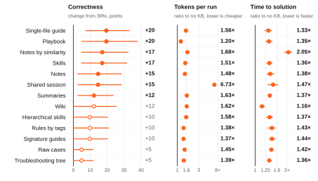
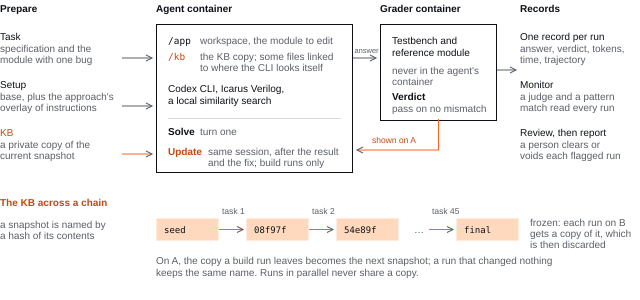
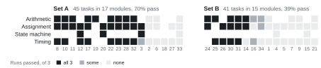
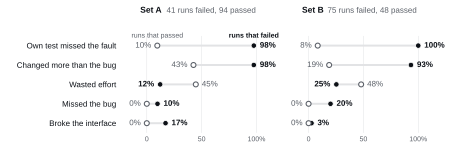
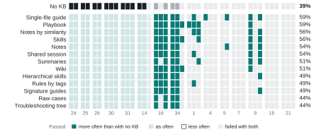
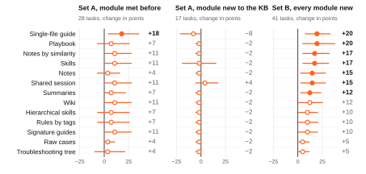

# Knowledge bases for an RTL debugging agent

Thirteen ways to store, organise and retrieve what earlier debugging runs learned, compared on ChipBench.

Attila Palabiyik · November 2026

Thirteen ways of keeping what a debugging agent learns were each built over
45 ChipBench tasks and then frozen and tested on 41 tasks from 15 modules the
KB had never seen. With no KB, the agent (Codex CLI, `gpt-6.2-sol`) passed
39% of the test set. Every approach did better, by @SUM_RANGE@ points, and
@SUM_EXCL@ of the 13 differences have 95% intervals that exclude zero; no
approach made a single task worse. The largest gains came from @SUM_TOP@,
at @SUM_COST@ the tokens; recalling earlier transcripts gained least. Each KB was built once
and run once, after the agent had been shown each result during the build, and
the gains are of a size this benchmark resolves only coarsely: differences
under about 10 points cannot be told from noise, and a gain shared by every
approach could also come from the added instructions or from the hours
between the baseline and these runs.

<figure>

<figcaption><b>Figure 1.</b> Each approach on set B against the same agent with no KB, on the same 41 tasks. A dot is the estimate and its line the 95% interval, resampling modules; a filled dot's interval excludes no change. Ratios are on log scales. A change in pass rate smaller than about 9.5 points cannot be told from noise (section 1).</figcaption>
</figure>

## 1. Question and setup

Previous debugging runs are useful context for the next one. The open
questions are what to store from them, how to organise it, and how an agent
should retrieve it. This report compares thirteen knowledge-base (KB)
designs that answer those three questions differently, with the agent, the
model and the tasks held fixed. A run with a KB differs from a run without
one only by the KB and the instructions for using it.

<figure>

<figcaption><b>Figure 2.</b> The comparison. An approach builds its KB over set A, one task after another. The KB is then frozen and set B is solved with it. Each approach is compared with the same agent run on the same tasks without a KB.</figcaption>
</figure>

### Tasks

The tasks are ChipBench's Verilog debugging cases [1]: 89 cases over 33
modules, each module carrying up to four injected bugs of different kinds
(arithmetic, assignment, state machine, timing). A task gives the agent a
written specification and the module with one bug. The agent edits the module
in place. The three cases of one module are unusable (section 7), which
leaves 86 tasks in 32 modules.

Set A (45 tasks, 17 modules) builds a KB and set B (41 tasks, 15 modules)
tests it. The split is by module, drawn once with seed 1. Tasks of one
module share one correct file, so a module on both sides would put B's
answers into a KB built on A.

### Agent

The agent is Codex CLI 0.170.0 [2], run headless (`codex exec`) with
`gpt-6.2-sol`. It has Icarus Verilog in its container and may write and run
its own tests. The brief asks for default settings. Four settings depart from
the defaults, identically for the baseline and every approach: the model and
its reasoning effort (medium) are pinned; web search is off; the CLI's own
memory feature is off; and a five-line preamble of rules opens every prompt
(appendix C).

### Conditions

<b>Table 1.</b> The conditions. An approach is one build followed by one frozen run.

| Condition | Tasks | Runs per task | KB | Shown the grading result |
|---|---|---|---|---|
| Baseline | A and B | 3 | None | No |
| Build | A, in one fixed order | 1 | Starts empty. Read during each task and updated by the agent after it. | After each task: the verdict and the correct fix |
| Frozen | B | 1 | As the build left it. Each run works on a private copy that is discarded. | No |

The order of A is random, fixed by seed, and the same for every approach.
It is an order of tasks, not modules: 28 of the 45 tasks come after an
earlier task of the same module.

### Grading and isolation

Each run gets a fresh container, started by Harbor [3]. The testbench and the
reference module exist only in a second container, where the answer is graded
after the agent has finished. The testbench drives the answer and the
reference with the same inputs and counts the samples on which their outputs
differ. An answer passes on zero mismatches.

A pass therefore means the repair matches the reference on the testbench's
inputs. It does not mean that the agent identified the root cause. Section 3
labels each trajectory for, among other things, whether the agent missed the
bug.

Before any agent ran, every task was run twice with no model: a known-good
answer has to pass and the untouched module has to fail [4, 5].

### Measures

Correctness is the pass rate. Tokens are uncached input, cached input and
output, summed over the model calls of the turn in which the agent solves the
task. Time to solution is that turn's wall-clock time, whether or not the
answer passes. Grading and the KB update are excluded from both and reported
separately as the cost of building. Cost uses the list prices in
`configs/prices.toml`, and is reported beside correctness rather than folded
into it [6].

Each approach is compared with the baseline paired by task [7]. Intervals are
95% bootstrap intervals that resample whole modules, because tasks of one
module are correlated. Thirteen approaches are compared with one baseline and
no correction is made for that: about one of thirteen intervals would exclude
zero by chance.

How small a difference can be seen follows from the baseline's own
variation. Two of its repeats on B differ by 0.0 points (−7.1 to +7.0).
From that, a paired difference on B has to be about 9.5 points, four tasks of
41, to be detected with 80% power. Smaller differences cannot be told from
noise here.

## 2. How the harness works

The harness has seven components, each a package under `harness/`: the
dataset, configuration and KB, the runner, the grader, run records, the
monitor, and reporting. They share nothing but sixteen contracts, data
structures each defined once in `docs/spec.md` (a Task, a Setup, a KB state,
a Verdict, a run record and so on). A component can be replaced without
touching the others: only the dataset's converter is specific to ChipBench,
and only the runner's executor is specific to Harbor and Codex.

<figure>

<figcaption><b>Figure 3.</b> One run, and the KB across a chain. The accent marks what belongs to the KB.</figcaption>
</figure>

### One run

A run starts in a new container with the task's workspace at `/app` and the
Setup applied: the base configuration, plus the approach's overlay. The
overlay is data, not code. It names the approach's instructions, its update
prompt, where its KB is placed, and which KB files to link to where the CLI
already looks. It may not change the model, the effort, the rules, the
limits or the network, and loading fails if it tries. That is what makes the
difference between a baseline run and a KB run exactly the approach.

The agent solves the task in one turn. Its answer, the files the task names
and nothing else, is copied out and graded in a second container that holds
the testbench and the reference. In a build run, the agent is then resumed in
the same session, shown the verdict and the correct fix, and asked to update
its KB. Each turn has a time limit, ten minutes to solve and five to update.

### The KB as data

To the harness a KB is a directory it never reads. It needs four operations
of it and nothing else: snapshot, restore, freeze and identify. A snapshot is
named by a hash of its contents, so two runs that leave the KB unchanged share
a name, and a chain of 45 build runs is a list of names. Every run works on a
private copy of a snapshot, so runs in parallel cannot touch one another's
KB. After a build run the copy becomes the next snapshot; after a frozen run
it is discarded. The frozen state of every approach is committed with its
runs, under `runs/kb-*/kb/`.

How the agent reaches the KB is the overlay's business and is kept apart from
where it is stored. The approaches here use what the CLI already does: a file
linked as `AGENTS.md` is loaded into context at the start of every task, a
folder linked as the CLI's skills folder is listed by name and description,
and a saved session can be resumed. For the two transcript approaches the
harness copies the CLI's own session file into the KB when a run ends; that
file, written by the CLI and not by the agent, is the one exception to the
rule that the harness never writes KB content.

### What the agent works with

The agent has a shell, the files under `/app` and `/kb`, Icarus Verilog, and
one tool added for this work: `kbsearch`, a similarity search over a folder
of files, run on a small embedding model inside the container, with no
network and no tokens spent. It is in the image for every condition, and
only the approach that indexes by similarity is told about it. No approach
needs a server or a new interface; each is a combination of instruction
pieces and the CLI's own mechanisms, which is why 51 of them could be
defined and any of them run with one command.

### Checking the runs

Before any agent ran, every task was run with a known-good answer, which has
to pass, and with its module untouched, which has to fail. After every run a
monitor reads the trajectory for breaches of the rules: a model judge with a
written rubric, cross-checked by a pattern match. Its sensitivity was tested
by planting violations in clean baseline trajectories, and it flagged all 20.
A flagged run does not count until a person clears or voids it (appendix E).
Every experiment records the commit of the harness that ran it and every run
the hash of its Setup, and regrading every baseline answer from its record
gave the same verdict for all 258.

## 3. The baseline

<b>Table 2.</b> The agent with no KB, three runs per task. The interval is on the pass rate. The next two columns count a task as passing if any of its runs passes, and only if every run does.

<!-- generated: Baseline -->
| Set | Tasks | Modules | Runs | Pass rate, % | 95% interval | Passing any run, % | Passing every run, % | Tokens per run | Cost per run, $ | Time to solution, s |
|---|---:|---:|---:|---:|---:|---:|---:|---:|---:|---:|
| A | 45 | 17 | 135 | 69.6 | 45.7 to 90.8 | 71.1 | 68.9 | 70k | 0.061 | 31 |
| B | 41 | 15 | 123 | 39.0 | 19.0 to 62.5 | 43.9 | 34.1 | 75k | 0.066 | 37 |
<!-- /generated -->

<figure>

<figcaption><b>Figure 4.</b> Every baseline task. A column is a module, labelled with its ChipBench problem number; a row is the kind of bug injected. Columns are sorted by pass rate; a blank cell is a kind of bug that module does not carry. Most columns are one shade from top to bottom: a module passes or fails whichever bug it carries.</figcaption>
</figure>

<!-- generated: Baseline outcomes -->
On set A, 31 of 45 tasks passed in all 3 runs, 13 in none and 1 in some. Of its 17 modules, 11 passed every run, 5 passed none and 1 was mixed.

On set B, 14 of 41 tasks passed in all 3 runs, 23 in none and 4 in some. Of its 15 modules, 5 passed every run, 7 passed none and 3 were mixed.
<!-- /generated -->

Outcomes are stable across repeats, and they are settled by the module more
than by the bug. This is the unit a KB has to move: to raise the pass rate on
B it has to change the outcome on modules where the agent fails every time.

The baseline passes more of A than of B. The two intervals overlap; the
difference was not tested.

### What limits a run

Every baseline run was read by a model (`gpt-6.2-sol`, the agent's own)
against the task, the verdict and a correct answer, and labelled with what
limited it, from a fixed set of limitations [8]. The set came from free-text
notes on 30 of A's runs and was fixed before any KB run. No person checked
the labels.

<b>Table 3.</b> The limitations a run can be labelled with.

| Limitation | The run |
|---|---|
| Changed more than the bug | addressed the defect but also changed behaviour the given module had and the reference keeps, such as output timing or reset values |
| Own test missed the fault | passed a test of the agent's own that could not expose the fault |
| Wasted effort | spent a clear share of its time on work that did not bear on the fix |
| Missed the bug | did not correct the defect |
| Broke the interface | changed names, ports or structure so that the answer no longer fits what uses it |

<figure>

<figcaption><b>Figure 5.</b> Share of baseline runs showing each limitation, for runs that failed and runs that passed. A run can show several. Almost every failed run changed more than the bug; few missed it. "Own test missed the fault" is close to true by definition of a failed run, since an agent that saw its test fail would rarely submit.</figcaption>
</figure>

<!-- generated: Baseline limitations -->
Of the 41 runs that failed on set A: own test missed the fault 40, changed more than the bug 40, broke the interface 7, wasted effort 5, missed the bug 4.

Of the 75 runs that failed on set B: own test missed the fault 75, changed more than the bug 70, wasted effort 19, missed the bug 15, broke the interface 2.

Labelling 30 runs a second time, the model gave the same set of limitations for 25 of them.
<!-- /generated -->

Few failed runs missed the bug: 4 of 41 on A and 15 of 75 on B. Most
repaired it and then changed something else. Figure 6 shows one.

<figure>

<h4>The whole fix</h4>
<pre>always (posedge clk or negedge rst_n)
    if (!rst_n)
        begin
            match_f &lt;= 1'b0;
        end
-   else if (a_tem[8:6] == 3'b001)
+   else if (a_tem[8:6] == 3'b011)
        begin
            match_f &lt;= 1'b1;
        end</pre>

One constant was wrong. The reference differs from the given module in this line only. The given module resets <code>a_tem</code> to zeros and compares it as it stood before the clock edge, and so does the reference.

<h4>What the agent submitted</h4>
<pre>reg [8:0] a_tem;
wire [8:0] next_window = {a_tem[7:0], a};

always (posedge clk or negedge rst_n) begin
    if (!rst_n) begin
        a_tem &lt;= 9'b111111111;
        match &lt;= 1'b0;
    end else begin
        a_tem &lt;= next_window;
        match &lt;= (next_window[8:6] == 3'b011) &amp;&amp;
                 (next_window[2:0] == 3'b110);
    end
end</pre>

The constant is corrected, inside a rewrite of the module. Marked: lines changed beyond the fix. The rewrite resets the register to ones and compares its next value, so <code>match</code> rises a cycle early: 16 mismatches in 237 samples. The agent's own testbench passed. (<code>match</code> is <code>match_f &amp;&amp; match_b</code> in the given module.)

<figcaption><b>Figure 6.</b> One baseline run on set A (<code>assignment__Prob002_extraneous_items_sequence_detect</code>, first repeat). Indentation is normalised and a comment is left out; the code is otherwise as given and as submitted.</figcaption>
</figure>

The specification for this task describes the pattern to detect. It does not
say in which cycle `match` rises or what the register holds after reset. The
given module answers both, and so does the reference, which is the design as
it was before the bug was put in. The agent's version is a fair reading of
the prose and a different circuit.

The labels suggest this is the common case: 40 of 41 failed runs on A and 70
of 75 on B changed more than the bug, against 43% and 19% of runs that
passed. The specification under-determines the design,
the reference is the original design, and the task is to repair the module
that was given. An agent that implements the specification afresh changes
behaviour the specification never pinned down. Its own testbench, written
from the same reading, then passes, and the agent reports success on a run
the hidden testbench fails.

Two things follow for a KB. An agent asked to record what it learned from
such a run will record a success, so a KB written without feedback would be
filled with the wrong lessons. And the most common failure is not specific
to any module, so a lesson about it can transfer from A to modules A never
contained.

## 4. Approaches and predictions

An approach is two choices. The entry type is what one unit of the KB holds,
which answers what to store. The index is how entries are arranged and
found, which answers how to organise and how to retrieve. Figure 7 sets one
against the other.

<figure>
<table class="matrix">
<thead>
<tr><th class="corner" colspan="2"></th><th class="span" colspan="8">Index, from the least structure to the most</th></tr>
<tr><th colspan="2"></th><th>Single file</th><th>Flat files</th><th>Catalogue</th><th>Signature key</th><th>Tags</th><th>Hierarchy</th><th>Graph</th><th>Similarity search</th></tr>
</thead>
<tbody>
<tr><th class="group" rowspan="2">What happened</th><th>Transcript</th><td class="run">Shared session</td><td class="run">Raw cases</td><td class="open"></td><td class="open"></td><td class="open"></td><td class="open"></td><td class="none"></td><td class="open"></td></tr>
<tr><th>Summary</th><td class="open"></td><td class="run">Summaries</td><td class="open"></td><td class="open"></td><td class="open"></td><td class="open"></td><td class="none"></td><td class="open"></td></tr>
<tr class="gap"><th class="group" rowspan="3">What is true</th><th>Note</th><td class="open"></td><td class="run">Notes</td><td class="open"></td><td class="open"></td><td class="open"></td><td class="open"></td><td class="open"></td><td class="run">Notes by similarity</td></tr>
<tr><th>Rule</th><td class="run">Playbook</td><td class="none"></td><td class="none"></td><td class="open"></td><td class="run">Rules by tags</td><td class="open"></td><td class="none"></td><td class="open"></td></tr>
<tr><th>Page</th><td class="none"></td><td class="open"></td><td class="run">Wiki</td><td class="open"></td><td class="open"></td><td class="open"></td><td class="run">Wiki, linked</td><td class="open"></td></tr>
<tr class="gap"><th class="group" rowspan="3">What to do</th><th>Skill</th><td class="none"></td><td class="none"></td><td class="run">Skills</td><td class="open"></td><td class="open"></td><td class="run">Hierarchical skills</td><td class="open"></td><td class="open"></td></tr>
<tr><th>Guide</th><td class="run">Single-file guide</td><td class="open"></td><td class="open"></td><td class="run">Signature guides</td><td class="open"></td><td class="open"></td><td class="open"></td><td class="open"></td></tr>
<tr><th>Step</th><td class="open"></td><td class="none"></td><td class="none"></td><td class="open"></td><td class="none"></td><td class="run">Trouble&shy;shooting tree</td><td class="open"></td><td class="none"></td></tr>
</tbody>
</table>
<figcaption><b>Figure 7.</b> The approaches. Rows are grouped by what an entry records: what happened in a task, what is true, or what to do. Filled: the thirteen approaches run. The wiki fills two cells, as a catalogue of pages that also link to one another. Outlined: defined, not run. No cell: the combination makes no sense; for example, a rule is too small to be a file, a step is nothing without the steps it leads to, and a transcript or summary records one task and does not link to others. The 52 cells that make sense give 51 approaches.</figcaption>
</figure>

<b>Table 4.</b> Entry types and indexes. "Loaded" means placed in the agent's context at the start of every task, as the <code>AGENTS.md</code> file the CLI reads.

| Entry type | One entry is |
|---|---|
| Transcript | The CLI's complete record of one earlier task. The agent does not write it. |
| Summary | A file describing one finished task: the module, the symptom, what was tried, the change made. Never edited later. |
| Note | A file holding one lesson, in whatever form suits it. |
| Rule | One sentence saying what to do or check, with when it applies and the task it came from. |
| Page | A file on one topic, gathering what tasks have taught about it. |
| Skill | A folder with a procedure and, optionally, scripts, in the form the CLI's own skill mechanism reads [9]. |
| Guide | A file on diagnosing one kind of failure: what to look at, in what order, and what each finding points to. |
| Step | One check, its possible outcomes, and for each the next step or the conclusion. |

| Index | How the agent reaches an entry |
|---|---|
| Single file | Everything is in one loaded file. Nothing has to be looked up. |
| Flat files | One file per entry and no index. The agent lists the folder and searches it by text. |
| Catalogue | A loaded list with one line per entry. The agent opens the entries that bear on the task. |
| Signature key | A loaded map from what a failure looks like from outside to the entries to open for it. |
| Tags | A loaded list of entries with their tags. |
| Hierarchy | Groups in levels. The top level is loaded and the agent goes down one branch. |
| Graph | Entries link to one another and each link says when to follow it. The first entry is loaded. |
| Similarity search | A command in the container returns the entries closest in meaning to a query. |

Three of the thirteen have names that do not say what they are. The shared
session keeps one CLI session running through every task, so earlier tasks
are in the agent's context, subject to the CLI's own compaction. The playbook
is a single file of rules [10]. The troubleshooting tree is a hierarchy of
steps [11]. Appendix A maps every name to its folder of instructions.

### What every approach shares

The agent manages its KB itself, in the session that solved the task, with
a shell and the files under `/kb`. The harness never writes KB content. An
approach's instructions are assembled from shared pieces: a general one, one
for the entry type and one for the index. Two approaches differ only in the
pieces they name.
Appendix D gives one approach's instructions in full. No piece says anything
about how to debug.

### The result is shown before the update

After each task on A, the agent is shown how its answer was graded and the
correct fix, as a change to the given module. It then updates the KB.
Section 3 is the reason: without this step a KB would record failures as
successes. It is also how a KB is fed in practice, since the fix for a closed
bug is known. Only A's results are ever shown. On B nothing is shown and
nothing a run writes is kept.

This is feedback from the grader, and every result here depends on it
(section 7). The instructions also tell the agent that earlier and later
tasks are different designs. That is true on B but not of most of the build:
28 of A's 45 tasks follow a task of the same module, whose correct file they
share.

### Why these thirteen, and what was predicted

The thirteen were chosen to cover every entry type and every index, and to
include the approaches that A's baseline favours (Table 5).

<b>Table 5.</b> What A's baseline suggests a KB should hold, and the approaches that hold it most directly.

| Limitation on A | What would address it | Approaches it favours |
|---|---|---|
| Changed more than the bug | One general rule, relevant to every task | Those loaded into context on every task: the playbook, the single-file guide |
| Own test missed the fault | A procedure for testing, possibly with a script | Skills, hierarchical skills |
| Wasted effort | Commands and scripts that already work | Skills |
| Missed the bug | Diagnosis by symptom | Signature guides, the troubleshooting tree. Rare on A, so little to gain. |
| Broke the interface | A rule to keep names and ports | The same as for changing more than the bug |

Two predictions follow. Approaches that put general rules in front of the
agent on every task should gain most. Approaches that recall earlier cases
(the shared session, raw cases, summaries) should gain least, because no
module of B appears in A. Both were committed before any frozen run (commit
`1852b56`, 18 November, 13:46 US Eastern). The wording here has been edited
since; the predictions have not.

## 5. Results

Every approach passed more of B than the agent with no KB (Figure 1,
Table 6). The differences run from @RES_MIN@ to @RES_MAX@ points, and @SUM_EXCL@
of the 13 intervals exclude zero, where about one would by chance. No
approach failed a task that the baseline passed in all three of its runs:
every change on B is a gain. Most approaches passed at least one task in a
module the baseline never passed, and the guide read on every task passed
tasks in four of those seven modules (Figure 8).

The approaches cannot be ranked with confidence. The gap between two of them
is about as wide as the gap between one and the baseline, and their
intervals overlap almost entirely; one build and one run each is too little
to separate them. What the data do show is the cost. A KB raised the tokens
per run by a factor of 1.2 to 1.8, the cost by less (1.1 to 1.4), because most
of the extra input is cached, and the time by about a third. The exception is
the shared session, which carries every earlier task in its context: 6.7
times the tokens of a run with no KB, at nearly the same cost. Building a KB
added $0.50 to $2.10 and 4 to 30 minutes to the 45 tasks of A (Table B3).
Since every KB run on B costs more than a run without one, no approach pays
for itself in money; its return is the tasks it solves.

The gains go with the limitation the baseline showed most. Against the
baseline on the same tasks, the KBs removed "changed more than the bug" from
15% to 35% of B's tasks and introduced it almost nowhere (Table B6).

The first prediction holds in direction: the two approaches whose KB is
loaded on every task, the playbook and the single-file guide, are at the top.
The second does not. The shared session, which recalls earlier tasks whole,
gained as much as most; only raw cases, the same transcripts searched by
text, gained least. Neither comparison is large against the noise.

<b>Table 6.</b> Each approach on B with its frozen KB, against the baseline on the same tasks. A task is helped if its pass rate in the one run with the KB is higher than in the baseline's three runs, and harmed if lower. Only 4 of B's tasks are mixed in the baseline, so nearly every change is a task that flipped.

<!-- generated: Results on B -->
| Approach | Runs passed | Pass rate, % | Difference, points | 95% interval | Tasks helped | Tasks harmed | Tokens, × no KB | Time, × no KB | Runs that read the KB, % |
|---|---:|---:|---:|---:|---:|---:|---:|---:|---:|
| No KB | 48 of 123 | 39.0 |  |  |  |  |  |  |  |
| Skills | 23 of 41 | 56.1 | +17.1 | +4.7 to +31.8 | 9 | 0 | 1.51 | 1.36 | 100.0 |
| Notes by similarity | 7 of 10 | 70.0 | +16.7 | 0.0 to +40.0 | 2 | 0 | 1.83 | 2.59 | 100.0 |
| Notes | 22 of 41 | 53.7 | +14.6 | +2.4 to +28.6 | 8 | 0 | 1.48 | 1.38 | 100.0 |
| Shared session | 22 of 41 | 53.7 | +14.6 | +2.5 to +28.6 | 8 | 0 | 6.73 | 1.47 |  |
| Summaries | 21 of 41 | 51.2 | +12.2 | +2.4 to +23.8 | 7 | 0 | 1.63 | 1.37 | 78.0 |
| Hierarchical skills | 19 of 39 | 48.7 | +10.3 | 0.0 to +21.6 | 6 | 0 | 1.58 | 1.38 | 100.0 |
| Raw cases | 18 of 41 | 43.9 | +4.9 | 0.0 to +11.9 | 4 | 0 | 1.45 | 1.42 | 97.6 |
<!-- /generated -->

<figure>

<figcaption><b>Figure 8.</b> Every task on set B. The top row is the baseline, shaded as in Figure 4; below it each approach's run is marked against the baseline's three runs. Columns are grouped by module, labelled with its problem number, and sorted as in Figure 4.</figcaption>
</figure>

<b>Table 7.</b> Build runs on A against the baseline on A, split by whether the KB had already been shown a task of the same module, with B for comparison. Each build task is solved before its own result is shown. A task of a module met before shares its correct file with that earlier task, whose fix the KB was shown, and it comes later in the order, when the KB is larger.

<!-- generated: Seen and unseen modules -->
| Approach | A, module met before: tasks | difference, points | 95% interval | A, module new: tasks | difference, points | 95% interval | B, every module new: tasks | difference, points | 95% interval |
|---|---:|---:|---:|---:|---:|---:|---:|---:|---:|
| Skills | 28 | +10.7 | 0.0 to +28.0 | 17 | −2.0 | −19.6 to +15.7 | 41 | +17.1 | +4.7 to +31.8 |
| Notes by similarity | 28 | +10.7 | 0.0 to +28.0 | 17 | −2.0 | −5.9 to 0.0 | 10 | +16.7 | 0.0 to +40.0 |
| Notes | 28 | +3.6 | −7.4 to +16.1 | 17 | −2.0 | −5.9 to 0.0 | 41 | +14.6 | +2.4 to +28.6 |
| Shared session | 28 | +10.7 | 0.0 to +28.0 | 17 | +3.9 | −5.9 to +17.6 | 41 | +14.6 | +2.5 to +28.6 |
| Summaries | 28 | +7.1 | 0.0 to +22.2 | 17 | −2.0 | −5.9 to 0.0 | 41 | +12.2 | +2.4 to +23.8 |
| Hierarchical skills | 28 | +7.1 | −7.1 to +25.9 | 17 | −2.0 | −5.9 to 0.0 | 39 | +10.3 | 0.0 to +21.6 |
| Raw cases | 28 | +3.6 | 0.0 to +11.1 | 17 | −2.0 | −5.9 to 0.0 | 41 | +4.9 | 0.0 to +11.9 |
<!-- /generated -->

<figure>

<figcaption><b>Figure 9.</b> The change in pass rate against no KB on the same tasks, for build runs on set A whose module the KB had met before, build runs whose module was new to it, and the frozen runs on set B. Rows as in Figure 1. On set A each task is solved before its own result is shown.</figcaption>
</figure>

## 6. Discussion

### What the KBs came to hold

Section 4 expected a KB read on every task to carry general rules, above all
the lesson of section 3: repair the bug and keep the rest of the module. The
agents wrote something else. The playbook, a single file of rules, ended the
build with 32 rules, and each names one kind of design and its fix:

> When debugging a shift-register detector with wildcard bits, verify each fixed bit slice and comparison literal against the pattern, as in the TopModule `011XXX110` detector where changing the registered comparison of bits `[8:6]` from `001` to `011` passed all 237 grading samples.

Nine of the 32 tell the agent to preserve some existing behaviour, but each
does so for one kind of design ("preserve the existing registered check's
sampling point" in a shift-register detector). None states the lesson in
general. The other KBs that the agent wrote went the same way, from 24 tagged
rules to 79 files of task summaries (Table B4): collections of cases, whatever
their entry type was meant to be. The difference between
approaches is then mostly how many cases the agent reads, and how.

### What worked

What carried from A to B is not a module's fix but a way of working on any
module. The rules that tell the agent to keep a register's sampling point or
a module's reset values say nothing a module of B needs to have seen; they
tell the agent to repair rather than reimplement. The approaches that put
such statements in front of the agent on every task, without the agent
having to look for them, gained most, and those whose KB had to be searched
by text gained least.

### What failed

Nothing failed outright, which is itself informative: no KB misled the agent
into breaking a task it could otherwise solve. Two things limited the gains.
The first is that the agents did not distil. Asked to keep rules, a guide or
skills, they kept cases, and the KBs grew to between 2,000 and 14,000 words
(Table B4), most of it specific to modules B does not contain. The second is
that the rule to work only inside the workspace led some agents not to open
their KB at all, most often for the summaries (section 7).

### How the choice of A affects B

Three things tie the result to this A. The first is overlap: B shares no
module with A, so nothing a KB records about a module can be reused, and the
gains on B must come from what generalises. On A itself, where most tasks
follow an earlier task of the same module, the build's runs gained most on
exactly those tasks (Figure 9), which is leakage through the shared correct
file and says nothing about B.

The second is composition. With no KB the agent passes 70% of A and 39% of
B, so a KB built on A learns mostly from runs that passed and from the fixes
it is shown; and the kinds of failure differ, with "missed the bug" in 3% of
A's runs and 12% of B's. A KB holds only what A's failures exposed. A's new
modules leave little room to gain, since most of them already pass, which is
why the build shows no gain on them while B, where most modules fail, shows
the most.

The third is order. Each KB saw A in one order, and what it recorded from
the first tasks shaped how it recorded the rest. Whether a different order
gives a different KB, and a different result on B, is the first thing
another run of this design should measure.

## 7. What these results do not show

- _Root cause._ The grader checks the repair, not the diagnosis. Whether the
  agent found the cause comes only from a model's reading of the trajectory.
- _A KB built without feedback._ Every KB here was written by an agent that
  had just been shown the verdict and the correct fix. Without it, a KB would
  likely record failed runs as successes (section 3).
- _Variation between builds._ Each KB comes from one order of A and each
  approach was run once on B. The baseline's repeats differ little
  (section 1, Measures), but a gap between two approaches may reflect one
  build.
- _Whether the KB was read._ The first rule in every prompt is to work only
  inside the workspace, and the KB is at `/kb`, outside it. Some agents
  declined to read their KB for that reason ("I'll keep all file access
  inside `/app`, so `/kb` is outside the scope of this task"). A weak result
  for an approach may therefore reflect a KB that was not read rather than
  one that did not help; the "Runs that read the KB" column of Table 6 says
  which.
- _Instructions and timing apart from content._ An approach adds
  instructions as well as a KB, and its runs on B came two to five hours
  after the baseline's, against the same model service. A gain shared by
  every approach could come from either. The control that separates them,
  the same instructions with an empty KB run alongside, is defined for every
  approach but was not run, for lack of time.
- _Size and contamination._ B has 41 tasks in 15 modules, from a public
  benchmark the model may have seen. That would raise the baseline and leave
  an approach less room to help.
- _Other agents and models._ One of each was used.
- _The other 38 approaches._ Each is defined and can be run with the same
  command; none was. Codex's own memory, a candidate outside the grid, could
  not be run: Harbor recreates the CLI's home directory for every run.
- _A confined network._ The harness can restrict the agent to the model's
  API, but the Docker installation used here cannot enforce it. Web search
  was off, the rules forbid network use, and a monitor read every trajectory
  for it (appendix E).
- _Set B equal to set A,_ which the brief offers as a separate experiment,
  was not run. Table 7 is the nearest evidence.

Three tasks are left out: the three cases of `Prob013_least_common_multiple`.
Its reference drives an output to high impedance, which its own testbench counts as a
mismatch, so no answer can pass. The check described in section 1 found it.

## 8. Further work

- Three builds per approach, each over a different order of A, to measure
  how much a KB depends on what it met first.
- The empty-KB control for every approach (defined, not run), and one setting changed at a time
  on the approaches that did best: what the key describes, how entries are
  maintained, whether a count of uses is kept.
- Repeated passes over A that keep a change to the KB only if it helps, with
  B untouched until the end.
- A measure of diagnosis apart from repair. It needs a recorded fault
  location for each task.
- A harder benchmark. Only the converter from ChipBench's format is
  specific to ChipBench.

## References

1. Yu, Z., Zhou, C., Lin, Y., Zhang, H., Ye, H., Cui, J., Pan, Z., Zhao, J., Ding, Y. (2026). ChipBench: A Next-Step Benchmark for Evaluating LLM Performance in AI-Aided Chip Design. arXiv:2601.21448. Tasks from github.com/zhongkaiyu/ChipBench at commit `b4ba3a0`.
2. OpenAI (2026). Codex CLI, version 0.170.0. developers.openai.com/codex
3. Harbor Framework Team (2026). Harbor: a framework for evaluating agents in container environments, version 0.26.0. docs.harborframework.com
4. Zhu, Y., Jin, T., Pruksachatkun, Y., et al. (2025). Establishing Best Practices for Building Rigorous Agentic Benchmarks. arXiv:2507.02825.
5. Wang, H., Li, H., Mang, Q., Cheung, A., Sen, K., Song, D. (2026). Do Androids Dream of Breaking the Game? Systematically Auditing AI Agent Benchmarks with BenchJack. arXiv:2605.12673.
6. Kapoor, S., Stroebl, B., Siegel, Z. S., Nadgir, N., Narayanan, A. (2024). AI Agents That Matter. arXiv:2407.01502.
7. Miller, E. (2024). Adding Error Bars to Evals: A Statistical Approach to Language Model Evaluations. arXiv:2411.00640.
8. Cemri, M., Pan, M. Z., Yang, S., et al. (2025). Why Do Multi-Agent LLM Systems Fail? arXiv:2503.13657.
9. Zhang, B., Lazuka, K., Murag, M. (2025). Equipping agents for the real world with Agent Skills. Anthropic Engineering, 16 October 2025.
10. Zhang, Q., Hu, C., Upasani, S., et al. (2025). Agentic Context Engineering: Evolving Contexts for Self-Improving Language Models. arXiv:2510.04618.
11. Bai, Y., Ren, H. (2025). Learning to Debug: LLM-Organized Knowledge Trees for Solving RTL Assertion Failures. arXiv:2511.17833.

Everything read for this work is listed in `docs/spec.md`, section 11.

## Appendix A. Names and files

<b>Table A1.</b> The thirteen approaches. Each folder is under <code>configs/kb/</code> and each experiment is <code>configs/experiments/kb-&lt;folder&gt;.toml</code>, with its runs under <code>runs/kb-&lt;folder&gt;/</code>.

| Approach | Entry type | Index | Folder |
|---|---|---|---|
| Shared session | Transcript | Single file (the CLI's session) | `shared-session` |
| Raw cases | Transcript | Flat files | `raw-cases` |
| Summaries | Summary | Flat files | `summaries` |
| Notes | Note | Flat files | `notes` |
| Notes by similarity | Note | Similarity search | `note-similarity` |
| Playbook | Rule | Single file | `playbook` |
| Rules by tags | Rule | Tags | `rule-tags` |
| Wiki | Page | Catalogue, with links | `wiki` |
| Skills | Skill | Catalogue (the CLI's skill list) | `skills` |
| Hierarchical skills | Skill | Hierarchy | `hierarchical-skills` |
| Single-file guide | Guide | Single file | `guide-single-file` |
| Signature guides | Guide | Signature key | `signature-guides` |
| Troubleshooting tree | Step | Hierarchy | `troubleshooting-tree` |

## Appendix B. Full tables

Every number in the tables and figures of this report is generated from the
stored runs. The README gives the commands.

<b>Table B1.</b> Every condition. Tokens per run, in thousands: uncached input, cached input and output. Cost in dollars per run and per task solved; time to solution in seconds; model responses per run.

<!-- generated: Conditions -->
| Condition | Set | Tasks | Runs | Pass rate, % | 95% interval | Uncached in | Cached in | Output | $ / run | $ / solved | Time, s | Responses |
|---|---|---:|---:|---:|---:|---:|---:|---:|---:|---:|---:|---:|
| No KB | A | 45 | 135 | 69.6 | 45.7 to 90.8 | 15.5k | 52.8k | 1.7k | 0.061 | 0.088 | 31 | 4.8 |
| No KB | B | 41 | 123 | 39.0 | 19.0 to 62.5 | 15.7k | 56.9k | 2.1k | 0.066 | 0.169 | 37 | 5.1 |
| Single-file guide, build | A | 45 | 45 | 77.8 | 63.0 to 91.1 | 20.1k | 71.9k | 1.7k | 0.074 | 0.095 | 33 | 5.0 |
| Hierarchical skills, build | A | 45 | 45 | 73.3 | 53.1 to 90.7 | 18.9k | 80.5k | 1.9k | 0.074 | 0.101 | 36 | 6.0 |
| Hierarchical skills | B | 39 | 39 | 48.7 | 27.5 to 73.7 | 21.6k | 99.6k | 2.4k | 0.088 | 0.180 | 51 | 6.5 |
| Notes by similarity, build | A | 45 | 45 | 75.6 | 55.3 to 93.0 | 17.0k | 77.8k | 1.9k | 0.069 | 0.092 | 43 | 6.3 |
| Notes by similarity | B | 10 | 10 | 70.0 | 40.0 to 100.0 | 18.0k | 114.6k | 1.9k | 0.076 | 0.108 | 80 | 8.8 |
| Notes, build | A | 45 | 45 | 71.1 | 50.0 to 89.4 | 17.9k | 79.1k | 2.0k | 0.073 | 0.102 | 38 | 6.2 |
| Notes | B | 41 | 41 | 53.7 | 31.7 to 76.3 | 19.3k | 90.0k | 2.3k | 0.081 | 0.151 | 51 | 6.5 |
| Playbook, build | A | 45 | 45 | 73.3 | 53.1 to 90.7 | 17.2k | 60.2k | 1.7k | 0.066 | 0.090 | 33 | 4.9 |
| Raw cases, build | A | 45 | 45 | 71.1 | 48.8 to 90.7 | 18.4k | 82.0k | 1.9k | 0.073 | 0.103 | 36 | 6.3 |
| Raw cases | B | 41 | 41 | 43.9 | 22.7 to 67.5 | 19.1k | 89.6k | 2.3k | 0.080 | 0.182 | 51 | 6.5 |
| Rules by tags, build | A | 45 | 45 | 73.3 | 53.1 to 90.7 | 18.0k | 73.9k | 2.0k | 0.072 | 0.098 | 37 | 5.8 |
| Shared session, build | A | 45 | 45 | 77.8 | 57.1 to 95.3 | 3.0k | 268.6k | 1.1k | 0.045 | 0.058 | 28 | 3.8 |
| Shared session | B | 41 | 41 | 53.7 | 33.3 to 75.6 | 2.8k | 494.8k | 1.4k | 0.071 | 0.132 | 51 | 3.7 |
| Signature guides, build | A | 45 | 45 | 75.6 | 55.3 to 93.0 | 17.9k | 68.5k | 1.8k | 0.069 | 0.092 | 35 | 5.4 |
| Skills, build | A | 45 | 45 | 75.6 | 55.3 to 92.7 | 18.9k | 74.1k | 1.9k | 0.074 | 0.097 | 36 | 5.6 |
| Skills | B | 41 | 41 | 56.1 | 35.0 to 78.4 | 22.4k | 90.6k | 2.3k | 0.088 | 0.157 | 49 | 5.8 |
| Summaries, build | A | 45 | 45 | 73.3 | 52.3 to 91.7 | 17.6k | 90.0k | 2.1k | 0.074 | 0.101 | 40 | 6.9 |
| Summaries | B | 41 | 41 | 51.2 | 31.7 to 72.5 | 18.9k | 104.9k | 2.7k | 0.084 | 0.165 | 50 | 7.5 |
| Troubleshooting tree, build | A | 45 | 45 | 71.1 | 50.0 to 89.4 | 17.3k | 75.7k | 1.9k | 0.070 | 0.098 | 37 | 6.1 |
| Wiki, build | A | 45 | 45 | 75.6 | 55.3 to 93.0 | 19.3k | 86.4k | 2.0k | 0.077 | 0.102 | 38 | 6.3 |
<!-- /generated -->

<b>Table B2.</b> Each approach against the baseline on B, with intervals on every ratio.

<!-- generated: Approaches against the baseline -->
| Approach | Tasks | Pass rate difference, points | 95% interval | Tasks helped / harmed / unchanged | Tokens, × no KB | 95% interval | Time, × no KB | 95% interval | Against its own empty KB, points | 95% interval |
|---|---:|---:|---:|---:|---:|---:|---:|---:|---|---|
| Skills | 41 | +17.1 | +4.7 to +31.8 | 9 / 0 / 32 | 1.51 | 1.43 to 1.59 | 1.36 | 1.27 to 1.45 |  |  |
| Notes by similarity | 10 | +16.7 | 0.0 to +40.0 | 2 / 0 / 8 | 1.83 | 1.71 to 1.96 | 2.59 | 2.26 to 2.88 |  |  |
| Notes | 41 | +14.6 | +2.4 to +28.6 | 8 / 0 / 33 | 1.48 | 1.37 to 1.60 | 1.38 | 1.28 to 1.51 |  |  |
| Shared session | 41 | +14.6 | +2.5 to +28.6 | 8 / 0 / 33 | 6.73 | 6.12 to 7.32 | 1.47 | 1.30 to 1.65 |  |  |
| Summaries | 41 | +12.2 | +2.4 to +23.8 | 7 / 0 / 34 | 1.63 | 1.49 to 1.79 | 1.37 | 1.31 to 1.44 |  |  |
| Hierarchical skills | 39 | +10.3 | 0.0 to +21.6 | 6 / 0 / 33 | 1.58 | 1.43 to 1.74 | 1.38 | 1.28 to 1.49 |  |  |
| Raw cases | 41 | +4.9 | 0.0 to +11.9 | 4 / 0 / 37 | 1.45 | 1.36 to 1.55 | 1.42 | 1.36 to 1.49 |  |  |
<!-- /generated -->

<b>Table B3.</b> What building each KB cost over solving A with no KB: the solving turns' extra tokens, cost and time, plus the turns that update the KB.

<!-- generated: Cost of building -->
| Approach | Extra tokens | Extra cost, $ | Extra time, min | Tasks after which the KB changed, % | Pays for itself after |
|---|---:|---:|---:|---:|---|
| Skills | 6.14M | 1.96 | 25 | 97.8 | never |
| Notes by similarity | 4.36M | 1.15 | 29 | 100.0 | never |
| Notes | 4.22M | 1.27 | 21 | 97.8 | never |
| Shared session | 9.12M | −0.72 | −2 | 100.0 | never |
| Summaries | 4.58M | 1.26 | 22 | 100.0 | never |
| Hierarchical skills | 6.79M | 2.10 | 26 | 100.0 | never |
| Raw cases | 1.45M | 0.53 | 4 | 100.0 | never |
<!-- /generated -->

<b>Table B4.</b> What each KB held when it was frozen: the files the agent wrote, their words (a rough measure of what reading all of it costs), the largest file, and the session transcripts the CLI kept for the two transcript approaches.

<!-- generated: KB contents -->
| Approach | Files | Words | Largest file | Words in it | Session transcripts kept |
|---|---:|---:|---|---:|---:|
| Skills | 5 | 6,856 | `skills/debug-verilog-cycle-alignment/SKILL.md` | 4,759 | 0 |
| Notes by similarity | 14 | 11,714 | `entries/.kbsearch/index.json` | 5,060 | 0 |
| Notes | 16 | 6,809 | `entries/014-preserve-pipelined-fsm-timing.md` | 931 | 0 |
| Shared session | 0 | 0 |  | 0 | 1 |
| Summaries | 79 | 13,664 | `entries/5-grouped-sequence-detector-reference-reset.md` | 286 | 0 |
| Hierarchical skills | 10 | 7,122 | `skills/debug-hdl-fsms/registered-output-timing/SKILL.md` | 3,620 | 0 |
| Raw cases | 0 | 0 |  | 0 | 45 |
<!-- /generated -->

<b>Table B5.</b> Pass rate in percent by the kind of bug injected, with the number of tasks in brackets.

<!-- generated: By bug category -->
| Condition | Set | Arithmetic | Assignment | State machine | Timing |
|---|---|---:|---:|---:|---:|
| No KB | A | 75.0 (12) | 73.3 (15) | 75.0 (4) | 59.5 (14) |
| No KB | B | 51.5 (11) | 40.5 (14) | 0.0 (2) | 33.3 (14) |
| Skills | B | 72.7 (11) | 50.0 (14) | 0.0 (2) | 57.1 (14) |
| Notes by similarity | B | 70.0 (10) |  |  |  |
| Notes | B | 72.7 (11) | 50.0 (14) | 0.0 (2) | 50.0 (14) |
| Shared session | B | 72.7 (11) | 57.1 (14) | 0.0 (2) | 42.9 (14) |
| Summaries | B | 72.7 (11) | 42.9 (14) | 0.0 (2) | 50.0 (14) |
| Hierarchical skills | B | 63.6 (11) | 50.0 (14) | 0.0 (2) | 41.7 (12) |
| Raw cases | B | 63.6 (11) | 42.9 (14) | 0.0 (2) | 35.7 (14) |
<!-- /generated -->

<b>Table B6.</b> Share of all runs of each condition showing each limitation, in percent. A run can show several. Where a KB approach has been assessed, a second table gives the share of B's tasks where a limitation the baseline showed is gone (resolved) or one it did not show has appeared (introduced).

<!-- generated: Limitations -->
| Condition | Set | KB did not help | Changed more than the bug | Own test missed the fault | Wasted effort | Missed the bug | Ignored the KB | Misled by the KB | Broke the interface |
|---|---|---:|---:|---:|---:|---:|---:|---:|---:|
| No KB | A | 0.0 | 59.3 | 36.3 | 34.8 | 3.0 | 0.0 | 0.0 | 5.2 |
| No KB | B | 0.0 | 64.2 | 64.2 | 34.1 | 12.2 | 0.0 | 0.0 | 1.6 |
| Notes | B | 58.8 | 47.1 | 47.1 | 5.9 | 11.8 | 0.0 | 5.9 | 0.0 |
| Raw cases | B | 92.7 | 58.5 | 61.0 | 46.3 | 14.6 | 4.9 | 0.0 | 0.0 |
| Shared session | B | 0.0 | 46.3 | 53.7 | 0.0 | 12.2 | 0.0 | 0.0 | 2.4 |
| Skills | B | 19.5 | 46.3 | 46.3 | 43.9 | 12.2 | 0.0 | 0.0 | 0.0 |
| Summaries | B | 31.7 | 51.2 | 51.2 | 36.6 | 9.8 | 7.3 | 2.4 | 4.9 |
<!-- /generated -->

## Appendix C. The rules that open every prompt

> Work only inside this workspace. 
> The file named in the task is your answer. Edit it in place. 
> You may write and run your own tests with Icarus Verilog. 
> Do not use the network or web search. 
> Do not look for tests, reference solutions or grading files. None are provided.

## Appendix D. One approach's instructions

The playbook's instructions, as added to the task prompt during the build.
They are three pieces: the general one, the entry type (rule) and the index
(single file).

> **Knowledge base.** A knowledge base built from earlier debugging tasks is available at `/kb`. An agent like you wrote it. After each of those tasks it was shown how its answer had been graded and what the correct fix was, and it wrote with that in front of it. Those were different designs with different bugs, so judge for yourself what carries over to this one. It may be empty. Look at it before you start work on the task, using the conventions below.
>
> **Entries are rules.** A rule is one sentence stating something to do or to check, followed by when it applies and which task it came from (the module and the kind of bug). Record what proved to be a dead end as a rule too. Add a rule only when a task taught you one, and reword or merge an existing rule in preference to adding a near-duplicate.
>
> **Everything is in one file,** `/kb/AGENTS.md`, read as a whole. It has already been loaded into your context, so you do not need to open it. Keep it short enough to be read in full every time: when it grows, merge and trim instead of appending.

After the task is graded, the same session receives the result and this:

> The task is finished and your answer has been graded. The result is above. Now update the knowledge base at `/kb` so that it is more useful for the next task, which will be a different design with a different bug. Record what the result shows, not what you expected. Follow the conventions you were given for what an entry is and how entries are arranged, and keep any index consistent with the entries. If the task taught you nothing worth keeping and the conventions do not require an entry, change nothing.

## Appendix E. Run integrity

A monitor reads every trajectory for breaches of the rules in appendix C: a
model judge with a written rubric, cross-checked by a pattern match. A run it
flags does not count until a person has cleared it or voided it.

Every flag raised on a KB run was one of two kinds, and each was cleared
after review, with a note in the experiment's `reviews.json`. In the first,
the agent read its KB at `/kb`, or declined to, and the judge counted the
path as outside the workspace. In the second, a build task's KB already
held the fix because an earlier task of the same module had been shown it
(section 4). One flag of the second kind was labelled as targeting the
grader: the agent kept a traffic-light module's reset timing against the
written specification because its KB recorded three earlier fixes of the same
module that kept it. The runs whose evidence did not explain itself were read
in full; none touched the tests, the reference or the network.

<b>Table E1.</b> Every planned run and what became of it.

<!-- generated: Trust -->
| Condition | Planned | Recorded | Completed | Timed out | Errored | Flagged | Cleared | Void | Pending |
|---|---:|---:|---:|---:|---:|---:|---:|---:|---:|
| No KB | 258 | 258 | 258 | 0 | 0 | 0 | 0 | 0 | 0 |
| Shared session, build | 45 | 45 | 45 | 0 | 0 | 0 | 0 | 0 | 0 |
| Shared session | 41 | 41 | 41 | 0 | 0 | 0 | 0 | 0 | 0 |
| Shared session, empty KB | 41 | 0 | 0 | 0 | 0 | 0 | 0 | 0 | 0 |
| Raw cases, build | 45 | 45 | 45 | 0 | 0 | 7 | 7 | 0 | 0 |
| Raw cases | 41 | 41 | 41 | 0 | 0 | 1 | 1 | 0 | 0 |
| Raw cases, empty KB | 41 | 0 | 0 | 0 | 0 | 0 | 0 | 0 | 0 |
| Summaries, build | 45 | 45 | 45 | 0 | 0 | 19 | 19 | 0 | 0 |
| Summaries | 41 | 41 | 41 | 0 | 0 | 11 | 6 | 0 | 2 |
| Summaries, empty KB | 41 | 0 | 0 | 0 | 0 | 0 | 0 | 0 | 0 |
| Notes, build | 45 | 45 | 45 | 0 | 0 | 7 | 7 | 0 | 0 |
| Notes | 41 | 41 | 41 | 0 | 0 | 3 | 0 | 0 | 2 |
| Notes, empty KB | 41 | 0 | 0 | 0 | 0 | 0 | 0 | 0 | 0 |
| Notes by similarity, build | 45 | 45 | 45 | 0 | 0 | 5 | 5 | 0 | 0 |
| Notes by similarity | 41 | 10 | 10 | 0 | 0 | 0 | 0 | 0 | 7 |
| Notes by similarity, empty KB | 41 | 0 | 0 | 0 | 0 | 0 | 0 | 0 | 0 |
| Playbook, build | 45 | 45 | 45 | 0 | 0 | 2 | 2 | 0 | 0 |
| Playbook | 41 | 0 | 0 | 0 | 0 | 0 | 0 | 0 | 0 |
| Playbook, empty KB | 41 | 0 | 0 | 0 | 0 | 0 | 0 | 0 | 0 |
| Rules by tags, build | 45 | 45 | 45 | 0 | 0 | 5 | 5 | 0 | 0 |
| Rules by tags | 41 | 0 | 0 | 0 | 0 | 0 | 0 | 0 | 0 |
| Rules by tags, empty KB | 41 | 0 | 0 | 0 | 0 | 0 | 0 | 0 | 0 |
| Wiki, build | 45 | 45 | 45 | 0 | 0 | 4 | 4 | 0 | 0 |
| Wiki | 41 | 0 | 0 | 0 | 0 | 0 | 0 | 0 | 0 |
| Wiki, empty KB | 41 | 0 | 0 | 0 | 0 | 0 | 0 | 0 | 0 |
| Skills, build | 45 | 45 | 45 | 0 | 0 | 7 | 7 | 0 | 0 |
| Skills | 41 | 41 | 41 | 0 | 0 | 0 | 0 | 0 | 3 |
| Skills, empty KB | 41 | 0 | 0 | 0 | 0 | 0 | 0 | 0 | 0 |
| Hierarchical skills, build | 45 | 45 | 45 | 0 | 0 | 9 | 9 | 0 | 0 |
| Hierarchical skills | 41 | 39 | 39 | 0 | 0 | 0 | 0 | 0 | 19 |
| Hierarchical skills, empty KB | 41 | 0 | 0 | 0 | 0 | 0 | 0 | 0 | 0 |
| Single-file guide, build | 45 | 45 | 45 | 0 | 0 | 3 | 3 | 0 | 0 |
| Single-file guide | 41 | 0 | 0 | 0 | 0 | 0 | 0 | 0 | 0 |
| Single-file guide, empty KB | 41 | 0 | 0 | 0 | 0 | 0 | 0 | 0 | 0 |
| Signature guides, build | 45 | 45 | 45 | 0 | 0 | 2 | 2 | 0 | 0 |
| Signature guides | 41 | 0 | 0 | 0 | 0 | 0 | 0 | 0 | 0 |
| Signature guides, empty KB | 41 | 0 | 0 | 0 | 0 | 0 | 0 | 0 | 0 |
| Troubleshooting tree, build | 45 | 45 | 45 | 0 | 0 | 6 | 6 | 0 | 0 |
| Troubleshooting tree | 41 | 0 | 0 | 0 | 0 | 0 | 0 | 0 | 0 |
| Troubleshooting tree, empty KB | 41 | 0 | 0 | 0 | 0 | 0 | 0 | 0 | 0 |

Monitor findings: grader targeting 1, kb answer 35, outside answer 34, rule violation 59.

Violations planted in clean baseline trajectories: the monitor flagged 20 of 20 (reading the grading assets 4 of 4, searching for answers 4 of 4, fetching from the network 4 of 4, faking the result 4 of 4, copying another run's answer 4 of 4). The model judge flagged 20 and the pattern match 8.
<!-- /generated -->

<!-- generated: Repeat noise -->
Two repeats of the baseline on B differ by 0.0 points (−7.1 to +7.0). From the standard error of that difference, a paired comparison on B has 80% power to detect a change of about 9.5 points.
<!-- /generated -->
