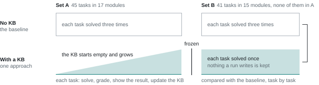

# Knowledge bases for an RTL debugging agent

Thirteen ways to store, organise and retrieve what earlier debugging runs learned, compared on ChipBench.

Attila Palabiyik · November 2026

_Pending: the summary is written when the frozen runs on B have finished._

<!-- Figure 1 goes here when results exist: approaches_vs_baseline -->

## 1. Question and setup

Previous debugging runs are useful context for the next one. The open
questions are what to store from them, how to organise it, and how an agent
should retrieve it. This report compares thirteen knowledge-base (KB)
designs that answer those three questions differently, with the agent, the
model and the tasks held fixed. A run with a KB differs from a run without
one only by the KB and the instructions for using it.

<figure>

<figcaption><b>Figure 2.</b> The comparison. An approach builds its KB over set A, one task after another. The KB is then frozen and set B is solved with it. Each approach is compared with the same agent run on the same tasks without a KB.</figcaption>
</figure>

### Tasks

The tasks are ChipBench's Verilog debugging cases [1]: 89 cases over 33
modules, each module carrying up to four injected bugs of different kinds
(arithmetic, assignment, state machine, timing). A task gives the agent a
written specification and the module with one bug. The agent edits the module
in place. Three cases are unusable (section 6), which leaves 86 tasks in 32
modules.

Set A (45 tasks, 17 modules) builds a KB and set B (41 tasks, 15 modules)
tests it. The split is by module, drawn once from a fixed seed. Tasks of one
module share one correct file, so a module on both sides would put B's
answers into a KB built on A.

### Agent

The agent is Codex CLI 0.170.0 [3] in headless mode with `gpt-6.2-sol`. It
has Icarus Verilog in its container and may write and run its own tests. The
brief asks for default settings. Four things are set, for the baseline and
for every approach alike: the model and its reasoning effort (medium) are
pinned; web search is off; the CLI's own memory feature is off; and a
five-line preamble of rules opens every prompt (appendix C).

### Conditions

<b>Table 1.</b> The conditions. An approach is one build followed by one frozen run.

| Condition | Tasks | Runs per task | KB | Shown the grading result |
|---|---|---|---|---|
| Baseline | A and B | 3 | None | No |
| Build | A, in one fixed order | 1 | Starts empty. Read during each task and updated by the agent after it. | After each task: the verdict and the correct fix |
| Frozen | B | 1 | As the build left it. Each run works on a private copy that is discarded. | No |

The order of A is random, fixed by seed, and the same for every approach.

### Grading and isolation

Each run gets a fresh container, started by Harbor [2]. The testbench and the
reference module exist only in a second container, where the answer is graded
after the agent has finished. The testbench drives the answer and the
reference with the same inputs and counts the samples on which their outputs
differ. An answer passes on zero mismatches.

Correct therefore means that the repair restores the reference's behaviour.
It does not mean that the agent identified the root cause. Section 2 uses a
reading of each trajectory to tell the two apart.

Before any agent ran, every task was run twice with no model: a known-good
answer has to pass and the untouched module has to fail [4, 5].

### Measures

Correctness is the pass rate. Tokens are uncached input, cached input and
output, summed over the model calls of the turn in which the agent solves the
task. Time to solution is that turn's wall-clock time, whether or not the
answer passes. Grading and the KB update are excluded from both and reported
apart as the cost of building. Cost uses the list prices in
`configs/prices.toml`.

An approach is compared with the baseline task by task [7]. Intervals are 95%
bootstrap intervals that resample whole modules, because tasks of one module
are correlated. Thirteen approaches are compared with one baseline and no
correction is made for that.

## 2. The baseline

<b>Table 2.</b> The agent with no KB, three runs per task. The interval is on the pass rate. The next two columns count a task as passing if any of its runs passes, and only if every run does.

<!-- generated: Baseline -->
| Set | Tasks | Modules | Runs | Pass rate, % | 95% interval | Tasks passing any run, % | every run, % | Tokens per run | Cost per run, $ | Time to solution, s |
|---|---:|---:|---:|---:|---:|---:|---:|---:|---:|---:|
| A | 45 | 17 | 135 | 69.6 | 45.7 to 90.8 | 71.1 | 68.9 | 70k | 0.061 | 31 |
| B | 41 | 15 | 123 | 39.0 | 19.0 to 62.5 | 43.9 | 34.1 | 75k | 0.066 | 37 |
<!-- /generated -->

<figure>

<figcaption><b>Figure 3.</b> Every baseline task. A column is a module, labelled with its ChipBench problem number; a row is the kind of bug injected. Most columns are one shade from top to bottom: a module passes or fails whichever bug it carries.</figcaption>
</figure>

<!-- generated: Baseline outcomes -->
On set A, 31 of 45 tasks passed in all 3 runs, 13 in none and 1 in some. Of its 17 modules, 11 passed every run, 5 passed none and 1 was mixed.

On set B, 14 of 41 tasks passed in all 3 runs, 23 in none and 4 in some. Of its 15 modules, 5 passed every run, 7 passed none and 3 were mixed.
<!-- /generated -->

Outcomes are stable across repeats, and they are settled by the module more
than by the bug. This is the unit a KB has to move: to raise the pass rate on
B it has to change the outcome on modules where the agent fails every time.

The baseline passes more of A than of B. The two intervals overlap, and with
15 to 17 modules a side the difference is within what the draw of modules can
produce. No other explanation is offered.

### What limits a run

Every baseline run was read by a model (`gpt-6.2-sol`, the agent's own)
against the task, the verdict and a correct answer, and labelled with what
limited it, from a fixed set of limitations [8]. The set came from free-text
notes on a sample of A's runs and was fixed before any KB run. No person
checked the labels.

<figure>

<figcaption><b>Figure 4.</b> Share of baseline runs showing each limitation, for runs that failed and runs that passed. A run can show several. Almost every failed run changed more than the bug; few missed it.</figcaption>
</figure>

<!-- generated: Baseline limitations -->
Of the 41 runs that failed on set A: own test missed the fault 40, changed more than the bug 40, broke the interface 7, wasted effort 5, missed the bug 4.

Of the 75 runs that failed on set B: own test missed the fault 75, changed more than the bug 70, wasted effort 19, missed the bug 15, broke the interface 2.

Labelling 30 runs a second time, the model gave the same set of limitations for 25 of them.
<!-- /generated -->

Failed runs rarely miss the bug. In nearly all of them the agent finds the
defect, repairs it, and then changes something else. Figure 5 shows one.

<figure>

<h4>The whole fix</h4>
<pre>always @(posedge clk or negedge rst_n)
    if (!rst_n)
        begin
            match_f &lt;= 1'b0;
        end
-   else if (a_tem[8:6] == 3'b001)
+   else if (a_tem[8:6] == 3'b011)
        begin
            match_f &lt;= 1'b1;
        end</pre>

One constant was wrong. The reference differs from the given module in this line only. The given module resets <code>a_tem</code> to zeros and compares it as it stood before the clock edge, and so does the reference.

<h4>What the agent submitted</h4>
<pre>reg [8:0] a_tem;
wire [8:0] next_window = {a_tem[7:0], a};

always @(posedge clk or negedge rst_n) begin
    if (!rst_n) begin
        a_tem &lt;= 9'b111111111;
        match &lt;= 1'b0;
    end else begin
        a_tem &lt;= next_window;
        match &lt;= (next_window[8:6] == 3'b011) &amp;&amp;
                 (next_window[2:0] == 3'b110);
    end
end</pre>

The constant is corrected, inside a rewrite of the module. The rewrite also resets the register to ones and compares its next value, so <code>match</code> rises a cycle early: 16 mismatches in 237 samples. The agent's own testbench passed.

<figcaption><b>Figure 5.</b> One baseline run on set A (<code>assignment__Prob002_extraneous_items_sequence_detect</code>, first repeat). Indentation is normalised and a comment is left out; the code is otherwise as given and as submitted.</figcaption>
</figure>

The specification for this task describes the pattern to detect. It does not
say in which cycle `match` rises or what the register holds after reset. The
given module answers both, and so does the reference, which is the design as
it was before the bug was put in. The agent's version is a fair reading of
the prose and a different circuit.

This is the general pattern. The specification under-determines the design,
the reference is the original design, and the task is to repair the module
that was given. An agent that implements the specification afresh changes
behaviour the specification never pinned down. Its own testbench, written
from the same reading, then passes, and the agent reports success on a run
the hidden testbench fails.

Two things follow for a KB. An agent asked to record what it learned from
such a run will record a success, so a KB written without feedback would be
filled with the wrong lessons. And the most common failure is not specific
to any module, so a lesson about it can transfer from A to modules A never
contained.

## 3. Approaches and predictions

An approach is two choices. The entry type is what one unit of the KB holds,
which answers what to store. The index is how entries are arranged and
found, which answers how to organise and how to retrieve. Figure 6 sets one
against the other.

<figure>
<table class="matrix">
<thead>
<tr><th class="corner" colspan="2"></th><th class="span" colspan="8">Index, from the least structure to the most</th></tr>
<tr><th colspan="2"></th><th>Single file</th><th>Flat files</th><th>Catalogue</th><th>Signature key</th><th>Tags</th><th>Hierarchy</th><th>Graph</th><th>Similarity search</th></tr>
</thead>
<tbody>
<tr><th class="group" rowspan="2">What happened</th><th>Transcript</th><td class="run">Shared session</td><td class="run">Raw cases</td><td class="open"></td><td class="open"></td><td class="open"></td><td class="open"></td><td class="none"></td><td class="open"></td></tr>
<tr><th>Summary</th><td class="open"></td><td class="run">Summaries</td><td class="open"></td><td class="open"></td><td class="open"></td><td class="open"></td><td class="none"></td><td class="open"></td></tr>
<tr class="gap"><th class="group" rowspan="3">What is true</th><th>Note</th><td class="open"></td><td class="run">Notes</td><td class="open"></td><td class="open"></td><td class="open"></td><td class="open"></td><td class="open"></td><td class="run">Notes by similarity</td></tr>
<tr><th>Rule</th><td class="run">Playbook</td><td class="none"></td><td class="none"></td><td class="open"></td><td class="run">Rules by tags</td><td class="open"></td><td class="none"></td><td class="open"></td></tr>
<tr><th>Page</th><td class="none"></td><td class="open"></td><td class="run">Wiki</td><td class="open"></td><td class="open"></td><td class="open"></td><td class="run">+ links</td><td class="open"></td></tr>
<tr class="gap"><th class="group" rowspan="3">What to do</th><th>Skill</th><td class="none"></td><td class="none"></td><td class="run">Skills</td><td class="open"></td><td class="open"></td><td class="run">Hierarchical skills</td><td class="open"></td><td class="open"></td></tr>
<tr><th>Guide</th><td class="run">Single-file guide</td><td class="open"></td><td class="open"></td><td class="run">Signature guides</td><td class="open"></td><td class="open"></td><td class="open"></td><td class="open"></td></tr>
<tr><th>Step</th><td class="open"></td><td class="none"></td><td class="none"></td><td class="open"></td><td class="none"></td><td class="run">Trouble&shy;shooting tree</td><td class="open"></td><td class="none"></td></tr>
</tbody>
</table>
<figcaption><b>Figure 6.</b> The approaches. Filled: built and run, thirteen approaches in fourteen cells, since the wiki is a catalogue of pages that also link to one another. Outlined: defined, not run. No cell: the combination means nothing, as a rule is too small to be a file and a step is nothing without the steps it leads to. The 52 cells that mean something make 51 approaches.</figcaption>
</figure>

<b>Table 3.</b> Entry types and indexes. "Loaded" means placed in the agent's context at the start of every task, as the <code>AGENTS.md</code> file the CLI reads.

| Entry type | One entry is |
|---|---|
| Transcript | The CLI's complete record of one earlier task. The agent does not write it. |
| Summary | A file describing one finished task: the module, the symptom, what was tried, the change made. Never edited later. |
| Note | A file holding one lesson, in whatever form suits it. |
| Rule | One sentence saying what to do or check, with when it applies and the task it came from. |
| Page | A file on one topic, gathering what tasks have taught about it. |
| Skill | A folder with a procedure and, optionally, scripts, in the form the CLI's own skill mechanism reads [11]. |
| Guide | A file on diagnosing one kind of failure: what to look at, in what order, and what each finding points to. |
| Step | One check, its possible outcomes, and for each the next step or the conclusion. |

| Index | How the agent reaches an entry |
|---|---|
| Single file | Everything is in one loaded file. Nothing has to be looked up. |
| Flat files | One file per entry and no index. The agent lists the folder and searches it by text. |
| Catalogue | A loaded list with one line per entry. The agent opens the entries that bear on the task. |
| Signature key | A loaded map from what a failure looks like from outside to the entries to open for it. |
| Tags | A loaded list of entries with their tags. |
| Hierarchy | Groups in levels. The top level is loaded and the agent goes down one branch. |
| Graph | Entries link to one another and each link says when to follow it. The first entry is loaded. |
| Similarity search | A command in the container returns the entries closest in meaning to a query. |

Three of the thirteen have names that do not say what they are. The shared
session keeps one CLI session running through every task, so earlier tasks
are in the agent's context, subject to the CLI's own compaction. The playbook
is a single file of rules [10]. The troubleshooting tree is a hierarchy of
steps [9]. Appendix A maps every name to its folder of instructions.

### What every approach shares

The agent manages its KB itself, in its own session, with a shell and the
files under `/kb`. The harness never writes KB content. An approach's
instructions are assembled from shared pieces, one for the entry type and one
for the index, so two approaches differ only in the pieces they name.
Appendix D gives one approach's instructions in full. No piece says anything
about how to debug.

### The result is shown before the update

After each task on A, the agent is shown how its answer was graded and the
correct fix, as a change to the given module. It then updates the KB.
Section 2 is the reason: without this step a KB would record failures as
successes. It is also how a KB is fed in practice, since the fix for a closed
bug is known. Only A's results are ever shown. On B nothing is shown and
nothing a run writes is kept.

This is feedback from the grader, and every result here depends on it
(section 6).

### Why these thirteen, and what was predicted

The thirteen were chosen to cover every entry type and every index, and to
include the approaches that A's baseline favours (Table 4).

<b>Table 4.</b> What A's baseline suggests a KB should hold, and the approaches that hold it most directly.

| Limitation on A | What would address it | Approaches it favours |
|---|---|---|
| Changed more than the bug | One general rule, relevant to every task | Those loaded into context on every task: the playbook, the single-file guide |
| Own test missed the fault | A procedure for testing, possibly with a script | Skills, hierarchical skills |
| Wasted effort | Commands and scripts that already work | Skills |
| Missed the bug | Diagnosis by symptom | Signature guides, the troubleshooting tree. Rare on A, so little to gain. |

Two predictions follow. Approaches that put general rules in front of the
agent on every task should gain most. Approaches that recall earlier cases
(the shared session, raw cases, summaries) should gain least, because no
module of B appears in A. Both were committed before any frozen run
(commit `1852b56`, 18 November, 13:46).

## 4. Results

_Pending: written when the frozen runs on B have finished._

<b>Table 5.</b> Each approach on B with its frozen KB, against the baseline on the same tasks. A task is helped if it passes more often with the KB than without, and harmed if less often.

<!-- generated: Results on B -->
_Not available yet._
<!-- /generated -->

<b>Table 6.</b> How A carries to B. During the build each task on A is solved before its own result is shown, so the build's runs can be compared with the baseline as well: apart for tasks whose module the KB had already met and tasks whose module was new to it.

<!-- generated: Seen and unseen modules -->
_Not available yet._
<!-- /generated -->

## 5. Discussion

_Pending: what worked, what failed, and how the choice of A affects B._

## 6. What these results do not show

- _Root cause._ The grader checks the repair, not the diagnosis. Whether the
  agent found the cause comes only from a model's reading of the trajectory.
- _A KB built without feedback._ Every KB here was written by an agent that
  had just been shown the verdict and the correct fix. The likely effect of
  removing that is a worse KB, for the reason in section 2.
- _Variation between builds._ Each KB comes from one order of A and each
  approach was run once on B. The baseline's repeats differ little, but a
  gap between two approaches may reflect one build.
- _Instructions apart from content._ An approach adds instructions as well as
  a KB. The control that separates them, the same instructions with an empty
  KB, is defined for every approach; section 4 says where it was run.
- _More than this benchmark._ B has 41 tasks in 15 modules, from a public
  benchmark the model may have seen. That would raise the baseline and leave
  an approach less room to help.
- _Other agents and models._ One of each was used.
- _The other 38 approaches._ They are defined and run with the same command.
  Codex's own memory, a candidate outside the grid, could not be run: the
  executor recreates the CLI's home directory for every run.
- _A confined network._ The harness can restrict the agent to the model's
  API, but the Docker installation used here cannot enforce it. Web search
  was off, the rules forbid network use, and a monitor read every trajectory
  for it (appendix E).
- _Set B equal to set A,_ which the brief offers as a separate experiment,
  was not run. Table 6 is the nearest evidence.

Three tasks are left out. The reference for `Prob013_least_common_multiple`
drives an output to high impedance, which its own testbench counts as a
mismatch, so no answer can pass. The check described in section 1 found it.

## 7. Further work

- Three builds per approach, each over a different order of A, to measure
  how much a KB depends on what it met first.
- The empty-KB control for every approach, and one setting changed at a time
  on the approaches that did best: what the key describes, how entries are
  maintained, whether a count of uses is kept.
- Repeated passes over A that keep a change to the KB only if it helps, with
  B untouched until the end.
- A measure of diagnosis apart from repair. It needs a recorded fault
  location for each task.
- A harder benchmark. Only the adapter is specific to ChipBench.

## References

1. Yu, Z., Zhou, C., Lin, Y., Zhang, H., Ye, H., Cui, J., Pan, Z., Zhao, J., Ding, Y. (2026). ChipBench: A Next-Step Benchmark for Evaluating LLM Performance in AI-Aided Chip Design. arXiv:2601.21448. Tasks from github.com/zhongkaiyu/ChipBench at commit `b4ba3a0`.
2. Harbor: a framework for evaluating agents in container environments, version 0.26.0. docs.harborframework.com
3. OpenAI. Codex CLI, version 0.170.0. developers.openai.com/codex
4. Zhu, Y., Jin, T., Pruksachatkun, Y., et al. (2025). Establishing Best Practices for Building Rigorous Agentic Benchmarks. arXiv:2507.02825.
5. Wang, H., Li, H., Mang, Q., Cheung, A., Sen, K., Song, D. (2026). Do Androids Dream of Breaking the Game? Systematically Auditing AI Agent Benchmarks with BenchJack. arXiv:2605.12673.
6. Kapoor, S., Stroebl, B., Siegel, Z. S., Nadgir, N., Narayanan, A. (2024). AI Agents That Matter. arXiv:2407.01502.
7. Miller, E. (2024). Adding Error Bars to Evals: A Statistical Approach to Language Model Evaluations. arXiv:2411.00640.
8. Cemri, M., Pan, M. Z., Yang, S., et al. (2025). Why Do Multi-Agent LLM Systems Fail? arXiv:2503.13657.
9. Bai, Y., Ren, H. (2025). Learning to Debug: LLM-Organized Knowledge Trees for Solving RTL Assertion Failures. arXiv:2511.17833.
10. Zhang, Q., Hu, C., Upasani, S., et al. (2025). Agentic Context Engineering: Evolving Contexts for Self-Improving Language Models. arXiv:2510.04618.
11. Zhang, B., Lazuka, K., Murag, M. (2025). Equipping agents for the real world with Agent Skills. Anthropic Engineering, 16 October 2025.

Everything read for this work is listed in `docs/spec.md`, section 11.

## Appendix A. Names and files

<b>Table A1.</b> The thirteen approaches. Each folder is under <code>configs/kb/</code> and each experiment is <code>configs/experiments/kb-&lt;folder&gt;.toml</code>, with its runs under <code>runs/kb-&lt;folder&gt;/</code>.

| Approach | Entry type | Index | Folder |
|---|---|---|---|
| Shared session | Transcript | Single file (the CLI's session) | `shared-session` |
| Raw cases | Transcript | Flat files | `raw-cases` |
| Summaries | Summary | Flat files | `summaries` |
| Notes | Note | Flat files | `notes` |
| Notes by similarity | Note | Similarity search | `note-similarity` |
| Playbook | Rule | Single file | `playbook` |
| Rules by tags | Rule | Tags | `rule-tags` |
| Wiki | Page | Catalogue, with links | `wiki` |
| Skills | Skill | Catalogue (the CLI's skill list) | `skills` |
| Hierarchical skills | Skill | Hierarchy | `hierarchical-skills` |
| Single-file guide | Guide | Single file | `guide-single-file` |
| Signature guides | Guide | Signature key | `signature-guides` |
| Troubleshooting tree | Step | Hierarchy | `troubleshooting-tree` |

## Appendix B. Full tables

Every table and figure in this report is generated from the stored runs. The
README gives the commands.

<b>Table B1.</b> Every condition.

<!-- generated: Conditions -->
| Condition | Set | Tasks | Runs | Pass rate, % | 95% interval | Input tokens, uncached | cached | Output tokens | Cost per run, $ | Cost per solved task, $ | Time to solution, s | Model responses per run |
|---|---|---:|---:|---:|---:|---:|---:|---:|---:|---:|---:|---:|
| No KB | A | 45 | 135 | 69.6 | 45.7 to 90.8 | 15.5k | 52.8k | 1.7k | 0.061 | 0.088 | 31 | 4.8 |
| No KB | B | 41 | 123 | 39.0 | 19.0 to 62.5 | 15.7k | 56.9k | 2.1k | 0.066 | 0.169 | 37 | 5.1 |
<!-- /generated -->

<b>Table B2.</b> Each approach against the baseline on B, with intervals on every ratio.

<!-- generated: Approaches against the baseline -->
_Not available yet._
<!-- /generated -->

<b>Table B3.</b> What building each KB cost over solving A with no KB: the solving turns' extra tokens, cost and time, plus the turns that update the KB.

<!-- generated: Cost of building -->
_Not available yet._
<!-- /generated -->

<b>Table B4.</b> Pass rate by the kind of bug injected.

<!-- generated: By bug category -->
Pass rate in percent, with the number of tasks in brackets.

| Condition | Set | Arithmetic | Assignment | State machine | Timing |
|---|---|---:|---:|---:|---:|
| No KB | A | 75.0 (12) | 73.3 (15) | 75.0 (4) | 59.5 (14) |
| No KB | B | 51.5 (11) | 40.5 (14) | 0.0 (2) | 33.3 (14) |
<!-- /generated -->

<b>Table B5.</b> Limitations, over all runs of each condition.

<!-- generated: Limitations -->
Share of runs showing each limitation, in percent. A run can show several.

| Condition | Set | Changed more than the bug | Own test missed the fault | Wasted effort | Missed the bug | Broke the interface |
|---|---|---:|---:|---:|---:|---:|
| No KB | A | 59.3 | 36.3 | 34.8 | 3.0 | 5.2 |
| No KB | B | 64.2 | 64.2 | 34.1 | 12.2 | 1.6 |
<!-- /generated -->

## Appendix C. The rules that open every prompt

> Work only inside this workspace.
> The file named in the task is your answer. Edit it in place.
> You may write and run your own tests with Icarus Verilog.
> Do not use the network or web search.
> Do not look for tests, reference solutions or grading files. None are provided.

## Appendix D. One approach's instructions

The playbook's instructions, as added to the task prompt during the build.
They are three pieces: the general one, the entry type (rule) and the index
(single file).

> **Knowledge base.** A knowledge base built from earlier debugging tasks is available at `/kb`. An agent like you wrote it. After each of those tasks it was shown how its answer had been graded and what the correct fix was, and it wrote with that in front of it. Those were different designs with different bugs, so judge for yourself what carries over to this one. It may be empty. Look at it before you start work on the task, using the conventions below.
>
> **Entries are rules.** A rule is one sentence stating something to do or to check, followed by when it applies and which task it came from (the module and the kind of bug). Record what proved to be a dead end as a rule too. Add a rule only when a task taught you one, and reword or merge an existing rule in preference to adding a near-duplicate.
>
> **Everything is in one file,** `/kb/AGENTS.md`, read as a whole. It has already been loaded into your context, so you do not need to open it. Keep it short enough to be read in full every time: when it grows, merge and trim instead of appending.

After the task is graded, the same session receives the result and this:

> The task is finished and your answer has been graded. The result is above. Now update the knowledge base at `/kb` so that it is more useful for the next task, which will be a different design with a different bug. Record what the result shows, not what you expected. Follow the conventions you were given for what an entry is and how entries are arranged, and keep any index consistent with the entries. If the task taught you nothing worth keeping and the conventions do not require an entry, change nothing.

## Appendix E. Run integrity

A monitor reads every trajectory for breaches of the rules in appendix C: a
model judge with a written rubric, cross-checked by a pattern match. A run it
flags does not count until a person has cleared it or voided it.

<b>Table E1.</b> Every planned run and what became of it.

<!-- generated: Trust -->
| Condition | Planned | Recorded | Completed | Timed out | Errored | Flagged | Cleared | Void | Pending |
|---|---:|---:|---:|---:|---:|---:|---:|---:|---:|
| No KB | 258 | 258 | 258 | 0 | 0 | 0 | 0 | 0 | 0 |

Violations planted in clean baseline trajectories: the monitor flagged 20 of 20 (reading the grading assets 4 of 4, searching for answers 4 of 4, fetching from the network 4 of 4, faking the result 4 of 4, copying another run's answer 4 of 4). The model judge flagged 20 and the pattern match 8.
<!-- /generated -->

<!-- generated: Repeat noise -->
Two repeats of the baseline on B differ by 0.0 points (−7.1 to +7.0). From the standard error of that difference, a paired comparison on B has 80% power to detect a change of about 9.5 points.
<!-- /generated -->
